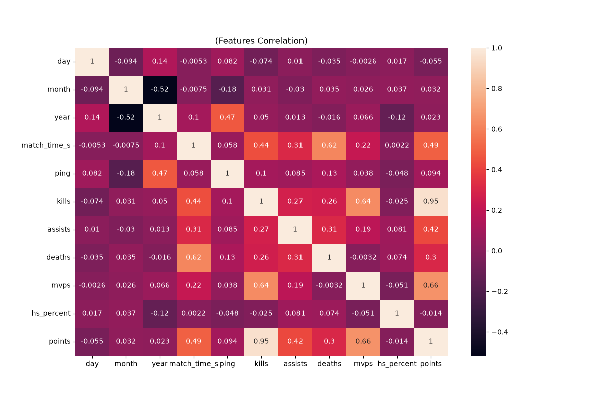
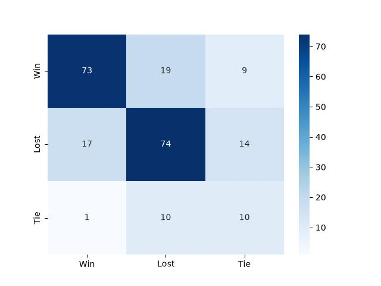
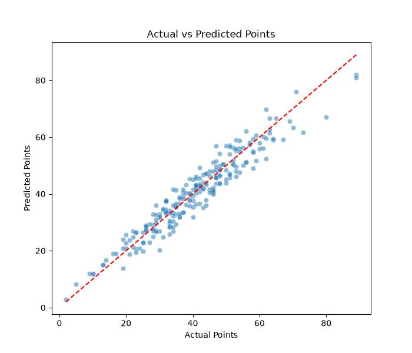

# CS-GO-Match-Prediction-Using-Machine-Learning

A personal Machine Learning project built to practice data preprocessing, model building, and evaluation using Python and Scikit-Learn. This project analyzes CS:GO (Counter-Strike: Global Offensive) match data to predict match outcomes and individual player performance points.

## 📌 Project Overview

This repository contains two main machine learning tasks based on a structured dataset (`csgo.csv`):

1. **Classification (`classification.py`)**: Predicting the final match result (Win, Lost, Tie).
2. **Regression (`regression.py`)**: Predicting a player's overall points based on their in-game statistics (kills, assists, deaths, etc.).

This project was built as a learning exercise to understand `scikit-learn` Pipelines, Data Preprocessing (handling missing values, scaling, encoding), and Hyperparameter Tuning.

## 📂 Repository Structure

- `csgo.csv` / `csgo.xlsx`: The datasets containing match statistics.
- `classification.py`: The script containing the Random Forest Classification model.
- `regression.py`: The script containing the Random Forest Regression model.
- `correlation.png`, `csgo_classification.jpg`, `csgo_regression_result.jpg`: Visualization charts.

## ⚙️ How the Pipeline Works

To ensure robust and clean data processing (and to prevent data leakage), this project utilizes `scikit-learn`'s `Pipeline` and `ColumnTransformer`:

- **Numerical Data** (e.g., kills, deaths, ping): Missing values are filled using `SimpleImputer` (median), and values are normalized using `StandardScaler` to ensure all features contribute equally.
- **Categorical Data** (e.g., map name): Missing values are filled using the most frequent value, and text categories are converted into machine-readable numbers using `OneHotEncoder`.

This automated pipeline ensures that any new, unseen match data can be passed directly into the model without requiring manual data cleaning.

## 📊 Exploratory Data Analysis (EDA)

Before building the models, I explored the relationships between numerical features to understand which factors impact the game the most. 

*Observation: Features like `kills`, `assists`, and `mvps`... show a strong positive correlation with the target variable `points`, making them excellent predictors.*



## 🤖 Models & Results

### 1. Match Outcome Classification (`classification.py`)
- **Goal:** Predict the outcome of a match (Win, Lost, Tie).
- **Model:** Random Forest Classifier (Optimized with `GridSearchCV` for hyperparameter tuning).
- **Addressing Imbalance:** Since "Tie" matches are rare, `class_weight="balanced"` was applied to help the model pay more attention to the minority class.
- **Result:** The model successfully learned to differentiate between winning and losing patterns.

**Confusion Matrix:**


### 2. Player Performance Regression (`regression.py`)
- **Goal:** Predict the final `points` of a player based on their in-game stats.
- **Model:** Random Forest Regressor.
- **Performance:** 
  - **R2 Score: ~0.918** (The model is highly accurate, successfully explaining almost 92% of the variance in player points).
  - **Mean Absolute Error (MAE): ~3.38** (On average, the model's prediction is only off by about 3 points from the actual score).

**Actual vs. Predicted Points:**
*The data points tightly cluster around the red dashed line (`y=x`), visually confirming the high accuracy of the regression model.*



## 🚀 How to Run Locally

1. Clone this repository to your local machine:
   ```bash
   git clone https://github.com/your-username/CS-GO-Match-Prediction-Using-Machine-Learning.git
   ```
2. Install the required libraries:
   ```bash
   pip install pandas numpy scikit-learn matplotlib seaborn
   ```
3. Run the classification script:
   ```bash
   python classification.py
   ```
4. Run the regression script:
   ```bash
   python regression.py
   ```

---
*Developed by a passionate student learning Data Science and Machine Learning.*
